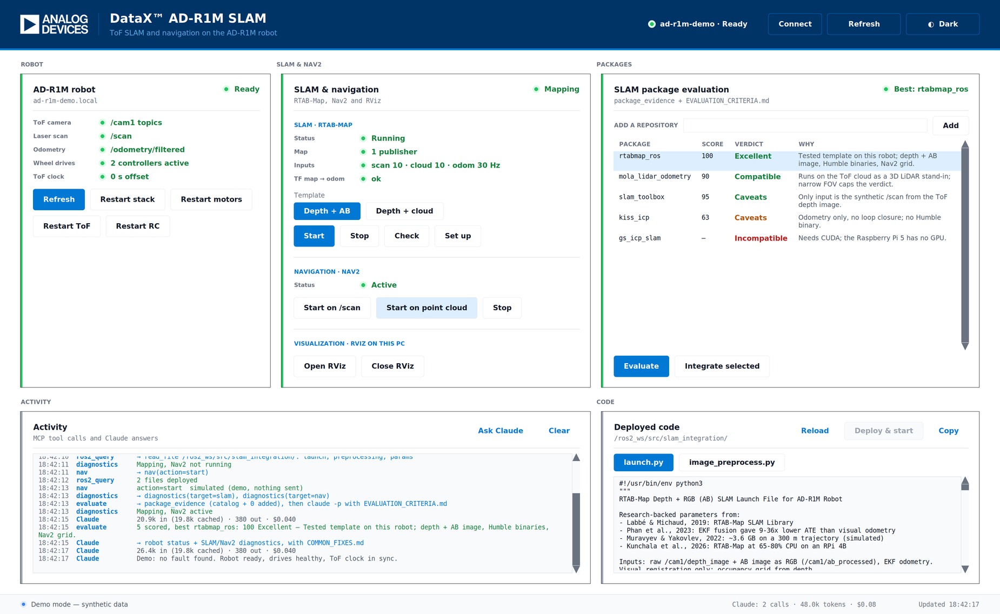
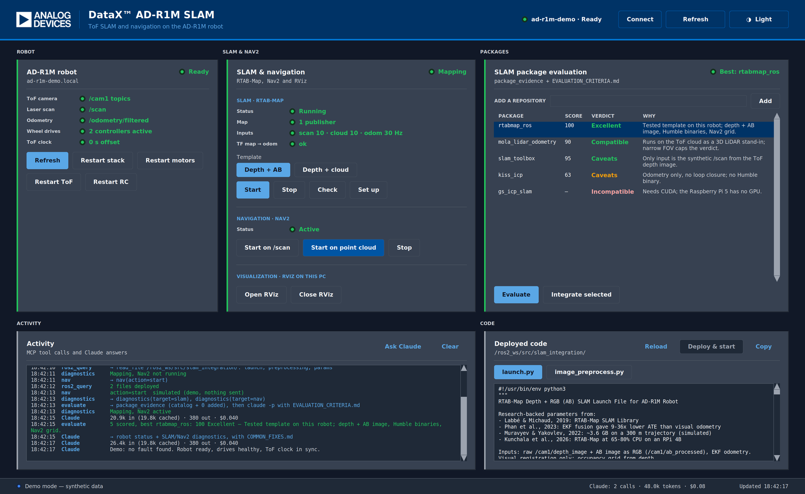

# ADI DataX&trade; — AD-R1M SLAM demo

A desktop control panel for SLAM and navigation on the
[AD-R1M](https://github.com/analogdevicesinc/ad-r1m-ros2) robot. It drives the robot through the
AD-R1M MCP server one folder up — the same tools Claude Code uses — and asks Claude to score SLAM
packages and diagnose faults from the `datax` skills.



<details>
<summary>Dark theme</summary>


</details>

## What it does

- **Robot** — connection state, ToF camera, `/scan`, odometry, wheel drives and the ToF clock
  offset from `robot_status`; restart the stack, the wheel drives (`slcan`), the ToF camera or the RC receiver (`crsf`).
- **SLAM & Nav2** — pick a tested RTAB-Map template (depth + AB image, or depth + point cloud),
  set up the SLAM workspace, start / stop / check SLAM, start Nav2 on `/scan` or the ToF point
  cloud, open RViz on this PC.
- **Packages** — `package_evidence` gathers live robot and repository facts, and Claude scores
  each package against the skill's `EVALUATION_CRITERIA.md`. *Add a repository* takes any git URL
  (e.g. `https://github.com/zang09/ORB_SLAM3_ROS2`), evaluates it the same way and adds it to the
  table; later *Evaluate* runs include it. The table scrolls; click a row, then
  *Integrate selected*: `setup_workspace` (from its repository when there is no binary), then the
  tested template for `rtabmap_ros` and `mola_lidar_odometry`, or a `launch.py` Claude writes
  from the `ad-r1m-slam-integration` skill. A generated file opens in *Code* and is deployed only
  when you press *Deploy & start*.
- **Activity** — every tool call and its result. *Ask Claude* sends the robot status, SLAM and
  Nav2 diagnostics and the recent log, with `COMMON_FIXES.md`, and prints the cause and fix.
- **Code** — the files deployed in the robot's `slam_integration` package (`launch.py`, the
  preprocessing nodes, `params.yaml` when there is one), one tab each, with *Copy*. Loaded after
  *Start SLAM*, or with *Reload*.
- **Claude usage** — each `claude -p` call logs its input (and cached) and output tokens and its
  cost; the status bar keeps the session total. Every call includes Claude Code's own system
  prompt, about 20k mostly cached tokens.

Robot calls run one at a time, in order; the buttons are disabled while one is running.

## Requirements

- **Python 3.8+** with `tkinter`, and **Pillow** (`pip3 install -r requirements.txt`).
- **Node.js 18+** and the MCP server's dependencies: `cd applications/ad-r1m && npm ci`.
- **`sshpass`**, and the robot on the same network. For a new robot, use the `ad-r1m-bringup`
  skill in Claude Code first.
- **`claude`** (Claude Code CLI, logged in) for *Evaluate* and *Ask Claude*. It runs with
  `claude -p` and no tools: the prompt carries the evidence.

## Run

```sh
python3 datax-ad-r1m-slam.py --demo     # canned data: no robot, no Claude
python3 datax-ad-r1m-slam.py            # live: press Connect, or uses the robot Claude Code selected
```

| Option | Default | Notes |
|---|---|---|
| `--demo` | off | Canned results for every panel. |
| `--theme {light,dark}` | `light` | Switchable at runtime (`Ctrl+T`). |
| `--ui-scale F` | autodetect | UI density factor. |
| `--server PATH` | `../server.mjs` | AD-R1M MCP server. |

The selected robot is shared with Claude Code (`~/.config/ad-r1m-slam/selected-robot.json`).
Cloudsmith credentials, when a tool needs them, come from `CLOUDSMITH_USER` / `CLOUDSMITH_TOKEN`
in the environment, as for the MCP server.

| Key | Action |
|---|---|
| `Ctrl+R` / `F5` | Refresh robot status |
| `Ctrl+T` | Toggle light / dark theme |
| `Ctrl+L` | Clear the activity log |

## Layout

| Path | Role |
|---|---|
| `datax-ad-r1m-slam.py` | The control panel: MCP stdio client, panels, window. |
| `design_system.py` | DataX visual language (palette, themes, spacing, `Button`, `Card`, `TextField`), from [dataX-collaterals](https://github.com/analogdevicesinc/dataX-collaterals) `applications/industrial-network`, BSD-3-Clause. Keep the two in step. |
| `assets/` | The Analog Devices logo (1x and 2x). |
| `docs/` | Screenshots used by this README. |
